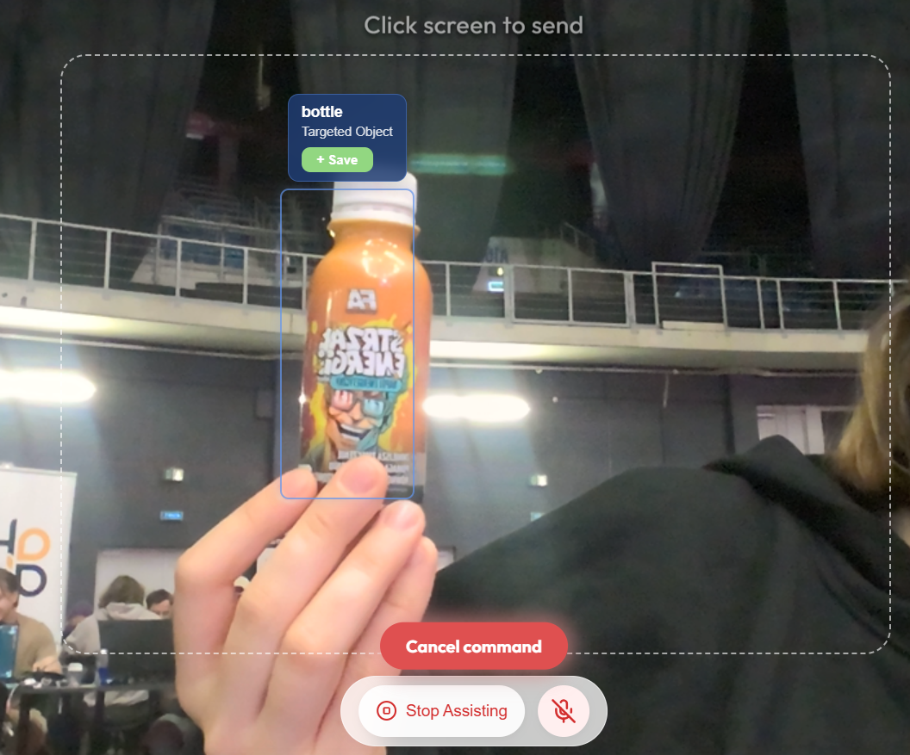
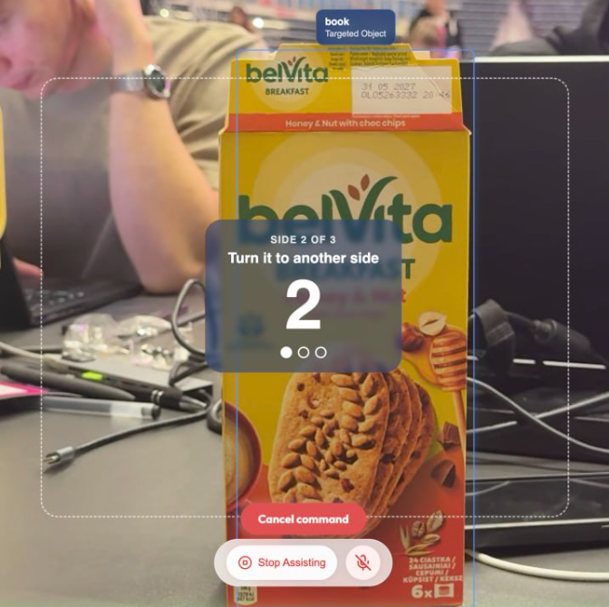
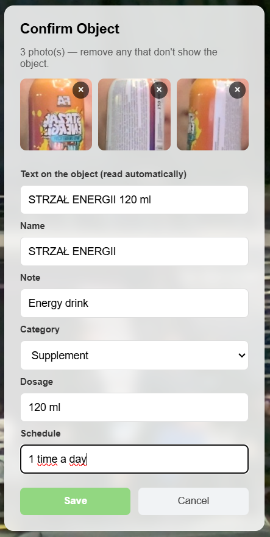
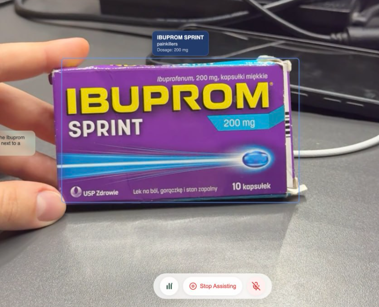
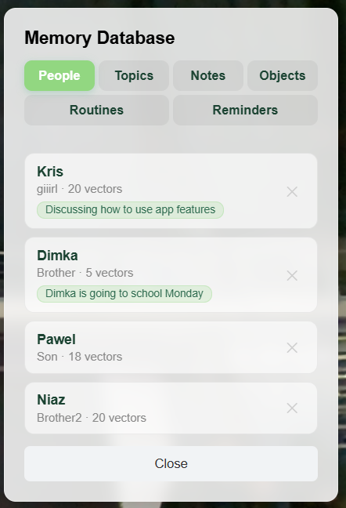
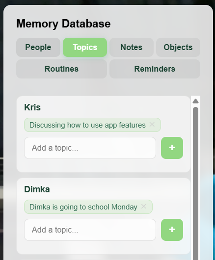
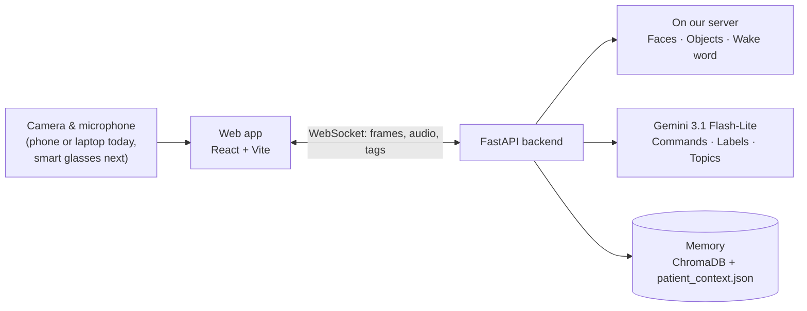

<p align="center">
  
</p>

<h1 align="center">Kinly</h1>

<p align="center">
  <b>An ambient memory companion for people living with memory loss.</b><br>
  <i>From “kin” — the people you love.</i>
</p>

<p align="center">
  Hackathon prototype · HackYeah 2026
</p>

---

## Why Kinly

Around **57 million people** live with dementia worldwide, and nearly **10 million new cases** are added every year ([WHO](https://www.who.int/news-room/fact-sheets/detail/dementia)). In everyday life that means:

- **Faces** — not recognising friends and family.
- **Conversations** — forgetting what was said, sometimes minutes later.
- **Medicines** — mixing up boxes that look almost the same.

Most assistive tools expect the user to open an app, type or navigate menus — exactly what is hard for someone with memory loss. Kinly works the other way round: it runs quietly in the background and helps without being asked. The end goal is **smart glasses**; today's prototype is a **web app** that uses a phone or laptop camera.

**Who it's for:** people with early dementia or memory decline, and the families and caregivers who set up the people, objects and medicines for them.

## What it does

| | |
|---|---|
| **Recognises people** | Shows the name, relation and last conversation topic over each familiar face. |
| **Remembers conversations** | While a known person is in view, the conversation is collected; 20 s after they leave, Gemini turns it into a short topic saved for that person. Works in any language. |
| **Knows your things** | Show an object from three sides once (a guided 3 × 2-second capture) and it is recognised from then on — with your note, dosage and schedule. |
| **Keeps medicines apart** | Reads the name and dosage printed on the box and uses it to tell look-alike packages apart. If the label can't be confirmed, Kinly shows nothing rather than guess. |
| **“Hey Kinly”** | Say “Hey Kinly” (or “Remind me”), then speak naturally: save a note, set a reminder, remember the object you're holding, add a conversation topic, or ask a question. |
| **One place for everything** | The Memory Database lets the family view and edit people, topics, notes, objects, routines and reminders. |

### Two modes

- **Ambient mode** — always on: name tags over faces, tags over saved objects, automatic conversation topics, and a short description of the surroundings when they change.
- **Command mode** — opened by “Hey Kinly” or the button. Only what is inside the centre frame is recognised; click the screen to send your spoken command.

## Screenshots

<!-- Add the images to docs/images/ with these file names (see docs/images/README.md). -->

| | |
|---|---|
|  |  |
| **Command mode** — the centre frame and the object to save | **Saving an object** — three sides, a countdown for each |
|  |  |
| **Save panel** — photos, label text, name, dosage | **Medicine** — the right box, with your note and dosage |
|  |  |
| **Memory Database** — people, topics, objects, reminders | **Conversation topic** — saved after the person leaves |

## How it works



| Component | Model / tool | Notes |
|---|---|---|
| Face detection | YuNet (via DeepFace) | ~0.1 s per frame on CPU |
| Face identity | Facenet512 (DeepFace) | Voting over the nearest stored vectors; tracking smooths names between frames |
| Wake word | Faster-Whisper `base` (int8) | Runs offline in its own process, with a “Kinly” hint so the name is heard correctly |
| Object detection | YOLOE-26s (open vocabulary) | A household word list, extended with the type of every saved object |
| Object identity | DINOv2-small | Each saved photo is stored with mirrored, brighter, darker and blurred variants |
| Commands, label reading, conversation topics, scene descriptions | Gemini 3.1 Flash-Lite | Structured JSON output |
| Spoken replies | Edge-TTS | |
| Memory | ChromaDB + `patient_context.json` | Vectors for faces and objects; notes, reminders, routines, objects and topics as JSON |

### Privacy

- **Stays on our server:** face and object recognition, and listening for the wake word.
- **Sent to Gemini (Google):** spoken commands, photos of saved objects when reading labels, a camera frame every ~30 s for the surroundings description (only when the scene has changed), and conversation audio with known people — the last one can be turned off in **Settings → Save conversation topics automatically**.
- **Sent to Microsoft Edge TTS:** the text of spoken replies.

## Getting started

Tested on **Windows 11 with Docker Desktop**.

**Requirements:** Docker Desktop (running) and a [Gemini API key](https://aistudio.google.com/apikey). A Hugging Face token is not needed.

1. **Add your Gemini key.** In PowerShell, in the project folder:
   ```powershell
   Set-Content -Path backend\.env -Value "GEMINI_API_KEY=your-key-here" -Encoding ascii
   ```
   Use this command rather than `echo ... > .env` — Windows PowerShell writes `echo` output in an encoding the backend can't read.

2. **Start the app:**
   ```powershell
   docker compose -f docker-compose.dev.yml up -d --build
   ```
   The first build downloads several GB and takes 10–20 minutes; the first start then downloads the AI models (a few more minutes). Later starts take about a minute.

3. **Wait for the backend:**
   ```powershell
   docker logs -f remindme-backend-dev
   ```
   Wait for `Application startup complete`, then press Ctrl+C.

4. **Open http://localhost:5173** in Chrome or Edge and allow camera and microphone access. Turn the microphone on (button on the right of the bottom bar) to use “Hey Kinly”.

| Task | Command |
|---|---|
| Start | `docker compose -f docker-compose.dev.yml up -d` |
| Stop | `docker compose -f docker-compose.dev.yml down` |
| Restart the backend | `docker compose -f docker-compose.dev.yml restart backend` |
| Backend logs | `docker logs -f remindme-backend-dev` |
| Check the backend | open http://localhost:8000/docs |

### Using an Android phone

With the phone connected by USB (USB debugging on), forward the ports and open the app in Chrome on the phone:

```powershell
adb reverse tcp:5173 tcp:5173
adb reverse tcp:8000 tcp:8000
```

Then go to **http://localhost:5173** on the phone. Everything still runs on the laptop; the phone is the camera, microphone and screen.

### Moving to another computer

The face and object vectors live in a Docker volume, not in git. On a new computer the people and objects listed in `patient_context.json` appear, but must be added again to be recognised.

## Project structure

```
kinly/
├── backend/
│   ├── main.py               # FastAPI app: WebSocket stream, modes, conversation topics, REST API
│   ├── face_processor.py     # Face detection + identity, frame-to-frame tracking
│   ├── object_processor.py   # YOLOE detection, DINOv2 matching, guided capture, label matching
│   ├── audio_processor.py    # "Hey Kinly" wake-word detection
│   ├── whisper_worker.py     # Whisper in its own process
│   ├── llm_orchestrator.py   # Gemini: commands, label reading, conversation topics, scene descriptions
│   ├── db.py                 # ChromaDB collections + patient_context.json
│   └── patient_context.json  # Notes, reminders, routines, objects, conversation topics
├── frontend/
│   ├── src/App.jsx                       # Camera, WebSocket, modes, tags, object capture
│   ├── src/components/DatabasePanel.jsx  # Memory Database
│   ├── src/components/KinlyLogo.jsx      # Logo
│   └── public/favicon.svg
├── docs/images/              # Screenshots used in this README
├── docker-compose.dev.yml    # Development setup (hot reload) — the tested way to run Kinly
└── docker-compose.yml        # Production setup (nginx) — not tested with the current version
```

## What's next

- **Smart glasses** — run Kinly on glasses, with hints right in the field of view.
- **Caregiver dashboard** — family adds people, objects and medicines remotely.
- **Safety mode** — notice disorientation and alert a caregiver.
- **Full offline operation** — no cloud AI needed.

<p align="center"><i>Because no one should forget alone.</i></p>
